# Master flowchart: everything in the SE syllabus (watch this before any unit)

Render: GitHub shows Mermaid natively. Exam weight from past papers: Unit 4 and 5 give the numericals (cyclomatic complexity, BVA, COCOMO, FP, metrics), Unit 2 gives diagrams (ER, DFD, state, use case), Unit 1 and 3 give definitions, comparisons and models.

```mermaid
flowchart TD
  SE(["Software Engineering"]) --> U1 & U2 & U3 & U4 & U5

  subgraph U1 ["UNIT 1: Introduction"]
    A1["Software, evolution, characteristics, components, applications"] --> A2["Software crisis: problems and causes"]
    A2 --> A3["SDLC: requirements, design, coding, testing, maintenance"]
    A3 --> A4["Structured vs Object Oriented Analysis and Design"]
    A4 --> A5["Agile intro: Scrum, XP, FDD, Crystal, DevOps"]
    A5 --> A6["Traditional vs Agile comparison"]
  end

  subgraph U2 ["UNIT 2: Requirements and modelling"]
    B1["Importance of RE, RE steps"] --> B2["Functional, Non-functional, Domain requirements"]
    B2 --> B3["Elicitation: interview, questionnaire, brainstorming, JAD, scenario, mind map"]
    B3 --> B4["Use case, scenario, use case diagram"]
    B4 --> B5["SRS IEEE 830 and its quality characteristics"]
    B5 --> B6["Modelling views: static ER, functional DFD, dynamic State Transition"]
    B6 --> B7["Data dictionary, process specification, UML intro"]
  end

  subgraph U3 ["UNIT 3: Design, architecture, process models"]
    C1["Coupling and cohesion types"] --> C2["Structure chart from DFD"]
    C2 --> C3["Architecture: importance, views, styles, decision template"]
    C3 --> C4["Design patterns"]
    C4 --> C5["Models: Waterfall, Prototype, Incremental, Evolutionary, RAD, Spiral, V, RUP"]
    C5 --> C6["Compare models: development, risk handling, testing approach"]
  end

  subgraph U4 ["UNIT 4: Testing (NUMERICALS)"]
    D1["Error, fault, failure; verification vs validation"] --> D2["Levels: unit, integration, system, acceptance"]
    D2 --> D3["White box: flow graph, cyclomatic complexity V(G)=E-N+2, basis paths, test cases"]
    D3 --> D4["Black box: BVA, equivalence class, decision table, cause-effect, state table"]
    D4 --> D5["Agile testing and TDD"]
  end

  subgraph U5 ["UNIT 5: Management, quality, metrics (NUMERICALS)"]
    E1["Size and quality metrics: LOC, failure percentage, DRE"] --> E2["Function Points: UFP x VAF"]
    E2 --> E3["COCOMO: effort, time, staff"]
    E3 --> E4["Scheduling: CPM, PERT, Gantt; staffing"]
    E4 --> E5["SCM, QA, monitoring (SPI, CPI)"]
    E5 --> E6["Risk: known/predictable/unpredictable, components, drivers, RE=PxC"]
    E6 --> E7["Quality dilemma; McCall; CMM 5 levels; ISO 9001; reliability"]
    E7 --> E8["Maintenance types; current trends"]
  end
```

